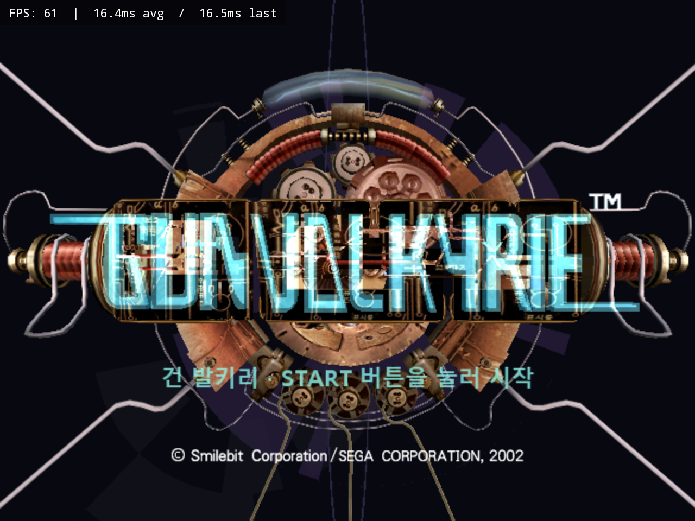
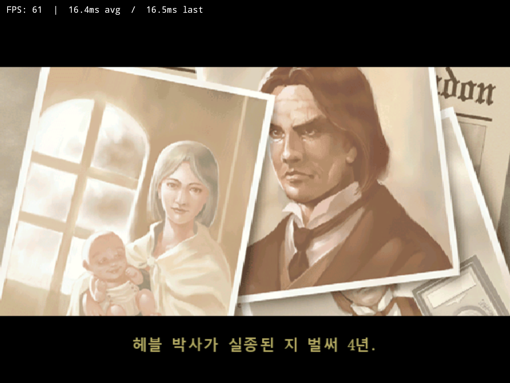
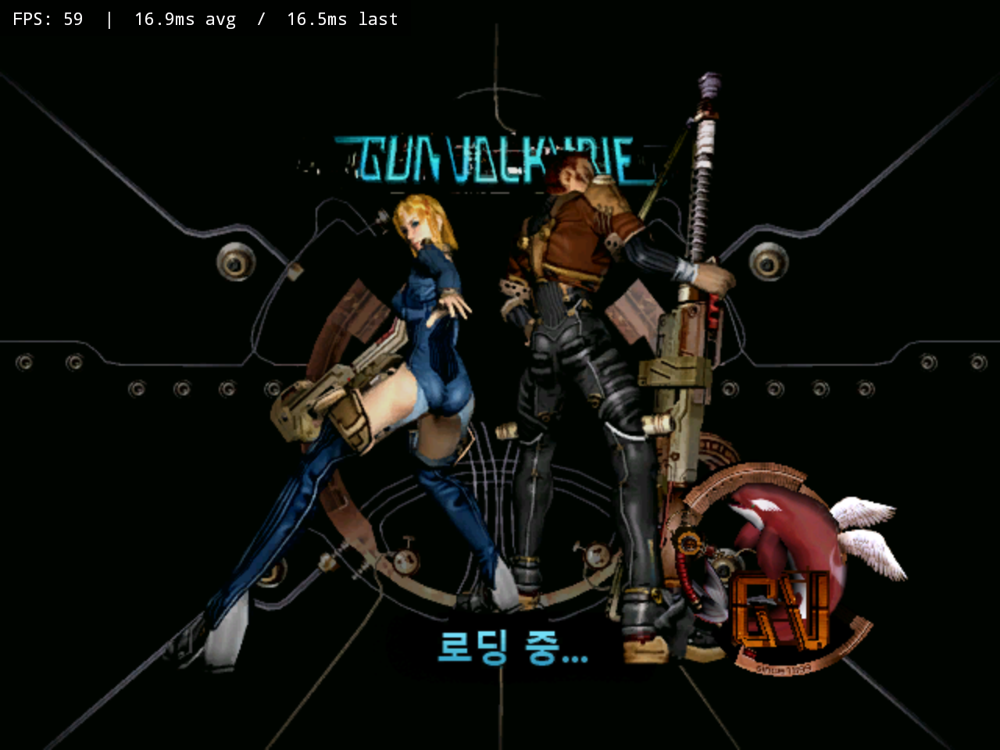
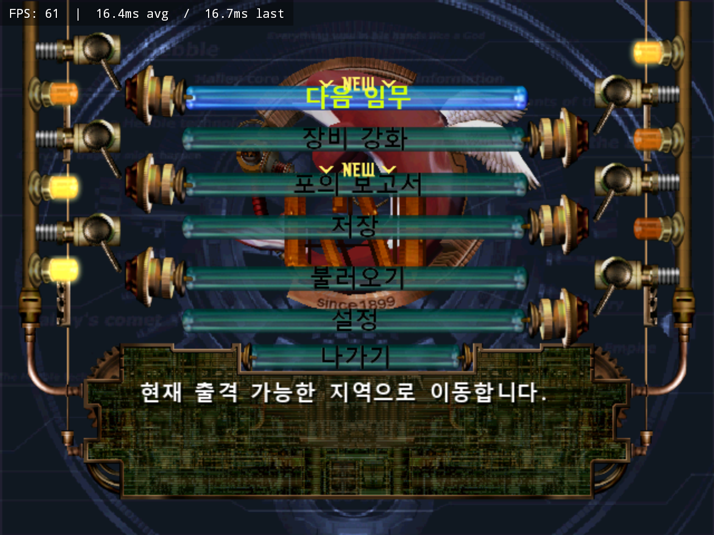
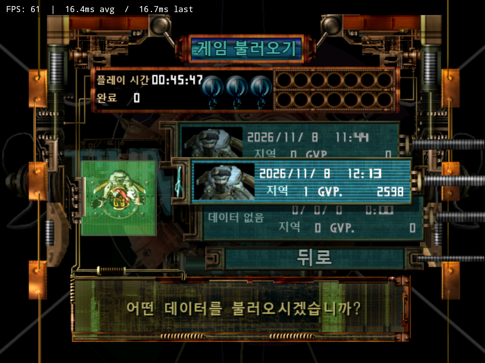
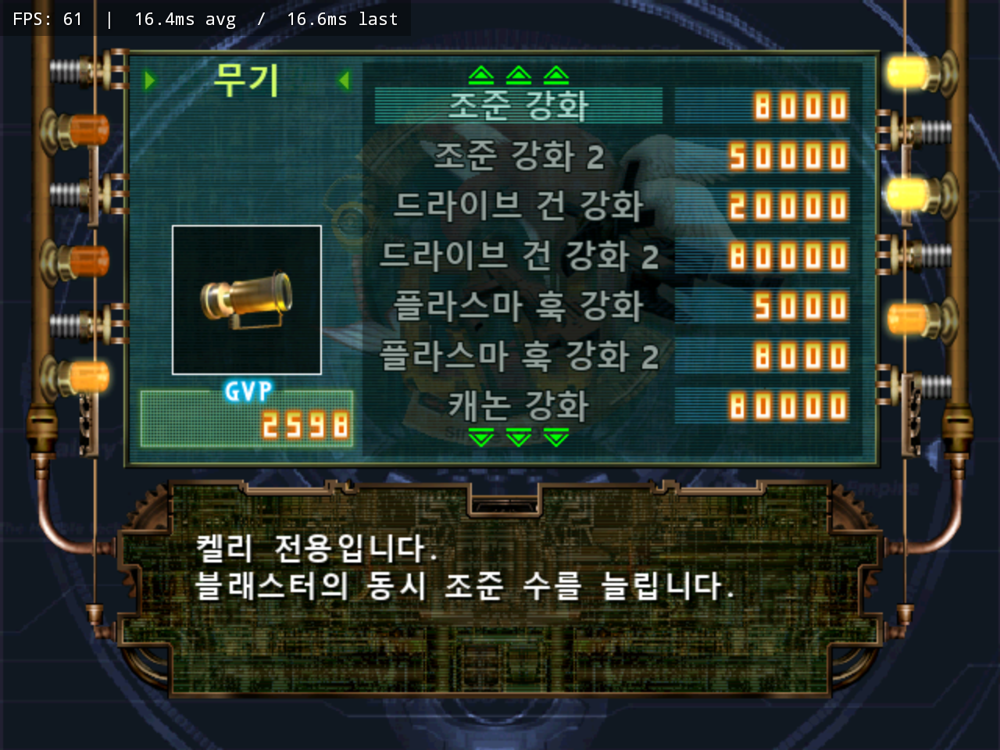

# 건 발키리 · GUNVALKYRIE

**Xbox 일본판 (En,Ja) 한국어 패치 V0.9**  
**코리아 로컬라이즈 GiKakNo**

## 다운로드

**[V0.9 EXE 패처 받기](https://github.com/OldManCraveGuitars-bit/XBOX-GunValkyrie-Kr/releases/tag/v0.9)**

`XBOX-GunValkyrie-Kr-v0.9-Patcher.exe` 하나로 원본 ISO 확인, 패치 적용,
결과 ISO 해시 검사까지 진행합니다. Windows 10/11의 .NET Framework를 사용하며
Python 설치나 인터넷 연결 없이 실행합니다. ZIP에는 같은 EXE와 사용법·해시 파일이 들어 있습니다.

## 사용법

1. EXE를 실행하고 **Gun Valkyrie (Japan) (En,Ja) 원본 ISO**를 선택합니다.
2. 한글 ISO를 저장할 **새 경로**를 지정합니다.
3. **한글 패치 시작**을 누르고 결과 SHA-256 검증 완료를 기다립니다.

원본과 기존 출력 파일은 덮어쓰지 않습니다. 이미 패치된 ISO에는 재적용하지 않습니다.
지원 원본과 생성 결과는 모두 **722,206,720바이트**입니다. 출력 드라이브에 800MB 이상을 확보하세요.
파일명이 같더라도 아래 원본 해시와 다르면 적용하지 않습니다.

게임 ISO·XBE는 배포 파일에 포함하지 않습니다. EXE에 내장된 데이터 차분을 사용합니다.

## 패치 내용

- 타이틀 안내, 메뉴, 저장·불러오기, 설정, 보고서와 일본어 문구 한국어화
- 오프닝의 원래 시간표를 사용하는 한국어 자막 활성화
- 한글 686자 획·여백 보정, 반각 공백 사용
- 저장·불러오기 제목의 영어 겹침과 `뒤로`의 별도 점멸 BACK 이미지 수정
- 예·아니요의 문단 폭과 글자 폭을 함께 계산해 선택 장식 위치 보정
- 무기 목록·비선택 글자 가독성 개선, 보고서와 공통 뒤로 안내 가운데 정렬
- 로딩 문구 크기·색상·분할 연출 보완, 요청에 따라 로딩의 원본 GUNVALKYRIE 로고 보존
- `코리아 로컬라이즈 GiKakNo` 크레딧

V0.9의 게임 데이터는 최신 내부 13차 수정본과 같습니다.

## SHA-256

| 대상 | SHA-256 |
| --- | --- |
| Japan (En,Ja) 원본 ISO | `33adbae5902b038ba42b156e7f4c2359008b4c02f34eefb05c56f1c6c126ce40` |
| V0.9 결과 ISO | `c975cdf2f76514f1bc53657567d682443bc804c92dd202144326e1803519cbd4` |

EXE·ZIP·차분 데이터의 해시는 [SHA256SUMS.txt](SHA256SUMS.txt)에,
MD5·SHA-1을 포함한 전체 해시는 [HASHES.md](HASHES.md)에 기록했습니다.

```powershell
Get-FileHash -Algorithm SHA256 -LiteralPath '.\XBOX-GunValkyrie-Kr-v0.9-Patcher.exe'
```

## 실행 스크린샷

메인 타이틀과 아래 사진 5장은 사용자가 제공한 실행 화면이며, 원본 그대로 실었습니다.
사진은 GitHub 소개에만 사용하고 EXE에는 넣지 않았습니다.

| 오프닝 자막 | 로딩 |
| --- | --- |
|  |  |

| 메인 메뉴 | 불러오기 |
| --- | --- |
|  |  |



## 검증

최종 배포 EXE로 원본 ISO를 패치한 결과가 위 결과 ISO 해시와 일치했습니다.
원본 보존, 잘못된 원본·손상된 차분·덮어쓰기 거부, 취소 정리 등 패처 검사 15개를 통과했습니다.
EXE에는 사진이나 별도 실행 프로그램을 포함하지 않습니다.

게임 데이터는 전체 1,366개 파일의 원래 크기와 위치를 유지합니다.
문자열 참조 868개, 한글 686자, 식자 영역 679개를 검사했고,
원본 대화창 렌더러의 선택 경로 28개와 게임이 갱신한 캐시 17개를 대조했습니다.
이 범위는 전체 플레이나 실기 검증 완료를 뜻하지 않습니다.

[검증 수치](docs/verification/localization-v0.9.json) ·
[패처 검증](docs/verification/patcher-v0.9.json) ·
[뒤로 점멸 비교](docs/images/back-flash-verification.png) ·
[선택 장식 좌표 비교](docs/images/choice-alignment-verification.png)

두 비교 PNG는 리소스와 원본 코드가 계산한 좌표의 합성이며, 위 사용자 제공 스크린샷과 구분합니다.

## 패처 빌드

Windows의 .NET Framework C# 컴파일러로 빌드합니다.
저장소에 내장 차분 데이터가 포함되어 있어 게임 ISO 없이 EXE를 빌드할 수 있습니다.

```powershell
.\tests\run.cmd
.\build.cmd
```

명령줄 적용도 지원합니다. 출력 ISO와 보고서에는 기존 파일과 겹치지 않는 새 경로를 지정하세요.

```powershell
.\dist\XBOX-GunValkyrie-Kr-v0.9-Patcher.exe --source '원본.iso' --output '한글.iso' --report '결과.json'
```

차분 형식과 재생성 방법은 [PATCH-FORMAT.md](docs/PATCH-FORMAT.md)에 있습니다.
게임과 원작 그래픽의 권리는 각 권리자에게 있으며, 이 패치는 SEGA의 공식 한국어판이 아닙니다.
