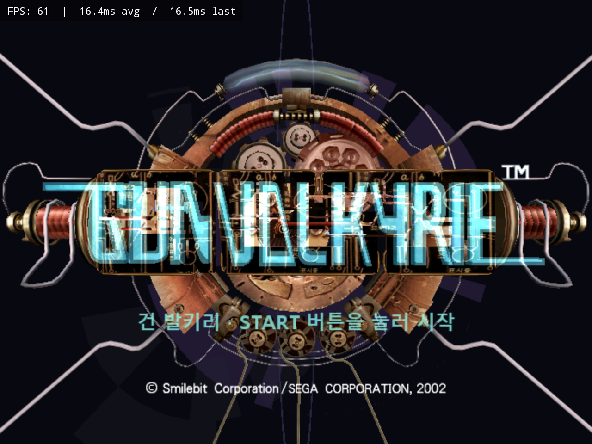

# 건 발키리 한국어 패치 V0.9

코리아 로컬라이즈 GiKakNo

## 받는 파일

- `XBOX-GunValkyrie-Kr-v0.9-Patcher.exe`: 단일 EXE 패처
- `XBOX-GunValkyrie-Kr-v0.9.zip`: 같은 EXE + 사용법 + 해시 파일
- `SHA256SUMS.txt`, `HASHES.txt`: 배포 파일과 원본·결과 ISO 해시
- `GunValkyrie-Kr-v0.9.gvpatch`: 빌드용 내장 차분 데이터

Windows에서 EXE를 실행해 일본판 (En,Ja) 원본 ISO와 새 저장 경로를 선택하세요.
원본과 결과의 SHA-256을 자동 검사합니다. Python 설치는 필요 없습니다.

## 원본과 결과 SHA-256

```text
원본: 33adbae5902b038ba42b156e7f4c2359008b4c02f34eefb05c56f1c6c126ce40
결과: c975cdf2f76514f1bc53657567d682443bc804c92dd202144326e1803519cbd4
```

원본·결과 크기: 722,206,720바이트. 원본과 기존 출력은 덮어쓰지 않습니다.
이미 패치된 ISO에는 다시 적용하지 않습니다.

최신 13차 수정 내용을 포함합니다. 메뉴·일본어 문구·오프닝 자막,
글자 획과 가독성, 저장/불러오기 겹침, 별도 BACK 점멸 이미지,
예·아니요 선택 장식 위치와 공통 안내 가운데 정렬을 반영했습니다.

메인 이미지는 사용자가 제공한 타이틀 실행 화면입니다.
사진 6장은 [README](https://github.com/OldManCraveGuitars-bit/XBOX-GunValkyrie-Kr#실행-스크린샷)에 실었고 EXE에는 넣지 않았습니다.

실제 EXE 적용 결과의 해시 일치와 패처 검사 15개를 확인했습니다.
게임 데이터·실행 코드·캐시 검사 범위는 README의 검증 항목을 참고하세요.
게임 전체 플레이 또는 실기 검증 완료를 뜻하지 않습니다.
